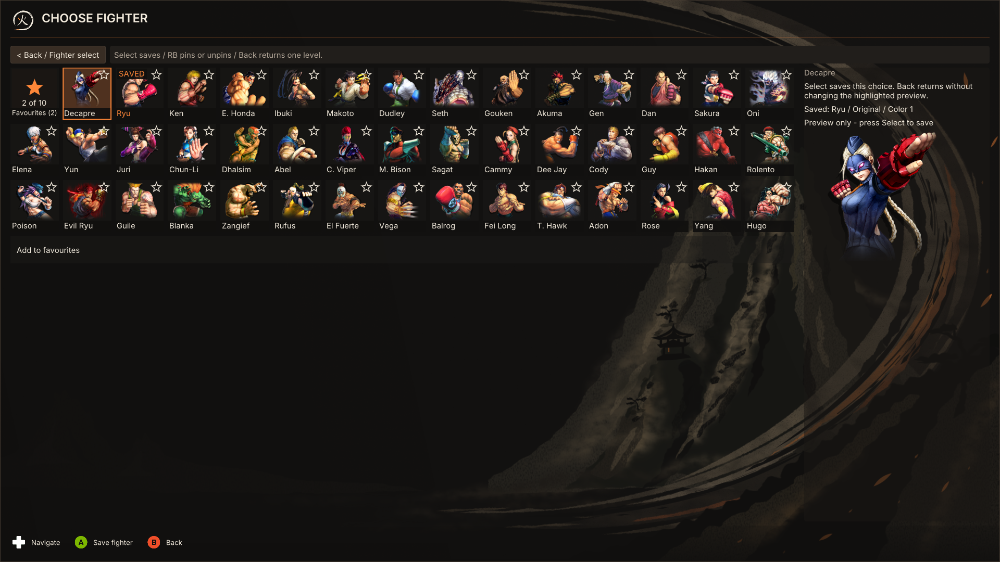
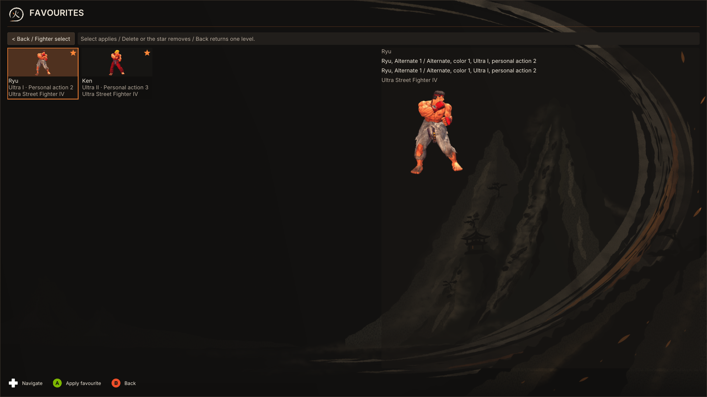

# Guía rápida: guardar y usar favoritos

> **En corto:** configura primero la combinación que quieres conservar. En la
> sala, abre Selección de luchador, enfoca la tarjeta de ese mismo luchador y
> pulsa **RB/R1**. Eso fija la combinación actual completa. Más adelante, pulsa
> **RB/R1** desde la sala para abrir Favoritos y **Select/A** sobre una tarjeta
> para aplicarla.

Un favorito no es solo un personaje: conserva el luchador, traje, color, Ultra,
edición y opciones personales. Se pueden guardar hasta diez combinaciones.

```text
Preparar el combo en la sala → X/F → enfocar el mismo luchador → RB/R1 → guardado
Usarlo después: sala → RB/R1 → tarjeta Favoritos → Select/A → combo aplicado
```

## Guardar tu combinación actual

1. **Prepara el combo en la sala.** En la fila **Luchador**, elige el personaje
   y luego el Ultra. En **Apariencia**, elige traje y color. En **Opciones del
   luchador**, ajusta **Acción personal** con izquierda/derecha. Cada fila
   actualiza la selección de la sala; todavía no la agrega a Favoritos.
2. **Abre Selección de luchador.** Pulsa el acceso que muestra la leyenda de la
   sala: **X** en Xbox, su equivalente en PlayStation, o **F** con teclado. La
   parrilla abre enfocada en el luchador seleccionado.
3. **Comprueba que el foco esté en ese mismo luchador.** No pulses Select aquí:
   Select inicia otra vez el flujo de selección. Para guardar el combo actual,
   pulsa **RB** (Xbox) o **R1** (PlayStation). Con teclado y ratón, haz clic en
   la estrella de la tarjeta.
4. **Confirma el resultado.** La estrella queda rellena y el contador de la
   tarjeta **Favoritos (N)** aumenta. Si ya existe esa combinación exacta, no
   crea un duplicado; la estrella permite quitarla.



### Si quieres guardar otro luchador

Primero prepara ese luchador y su combinación desde las filas de la sala; luego
vuelve a abrir la parrilla, enfoca su tarjeta y pulsa RB/R1. RB actúa sobre la
tarjeta enfocada. Si enfocas un luchador distinto al que está seleccionado, el
combo que se fija es la última combinación recordada para ese luchador, no el
combo vivo de otro personaje.

## Abrir y aplicar un favorito

1. Desde la sala, pulsa **RB/R1** para abrir directamente la página Favoritos.
   También puedes enfocar la fila **Favoritos** de la sala y pulsar Select/A.
2. Muévete hasta la tarjeta que quieres usar. La tarjeta muestra el personaje,
   la imagen del traje, el Ultra y la opción personal.
3. Pulsa **Select/A** para aplicar la combinación completa. La selección vuelve
   a la sala con ese combo listo. **RB/R1** en esta página vuelve a la parrilla
   sin aplicar nada.



## Quitar un favorito y casos límite

- En la parrilla, RB/R1 sobre una tarjeta con estrella rellena la quita. Con
  ratón, haz clic en la estrella.
- En la página Favoritos, **Delete** o la estrella quitan la tarjeta enfocada.
  **Nota:** actualmente no hay un botón de mando dedicado para quitar una
  tarjeta desde esa página; se puede volver a la parrilla y alternar la
  estrella, o usar Delete/ratón.
- El límite es diez. Si está llena, primero quita una combinación.
- El mismo personaje puede aparecer varias veces si cambia el resto del combo;
  dos combinaciones idénticas no se duplican.
- La disponibilidad local y las reglas de edición de la sala siguen aplicando.
  Si un combo no está disponible en esta instalación o sala, no se aplica.

## Qué muestran estas capturas

Son capturas de la UI real del selector a **1920×1080**, con dos combinaciones
de ejemplo cargadas para ilustrar la parrilla y la página Favoritos. No son una
captura de una sala online en vivo; en una sala, la leyenda de botones también
muestra los atajos disponibles para el mando conectado.
